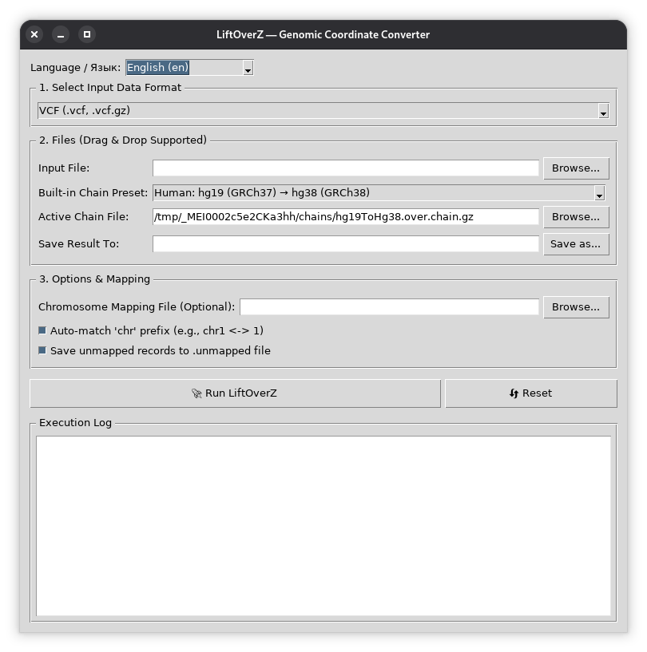

# LiftOverZ - A fast, standalone, cross-platform graphical tool for lifting over genomic coordinates across genome assembly builds.


**Languages: [English](#english) | [Русский](#русский)**

---

<a name="english"></a>
## English

**LiftOverZ** is a fast, standalone, cross-platform graphical tool designed for lifting over genomic coordinates across genome assembly builds (e.g., hg19/GRCh37, hg38/GRCh38, T2T-CHM13v2, and mouse builds).

It requires **no installation**, runs as a single portable executable, includes **pre-bundled UCSC chain files with selected mitochondrial fixes**, supports **Drag & Drop**, handles compressed files (`.gz`) out of the box, preserves chromosome naming styles (UCSC vs. Ensembl/NCBI), supports **optional target FASTA reference validation**, features hot-swappable multilingual support, and includes a **full Command Line Interface (CLI)** for headless server integration.

---

## Screenshot



---

### Key Features

* **Zero Installation / 100% Portable:** Single executable running out of the box on Windows 11/10, Linux, and macOS.
* **Native Cross-Platform Binaries:**
  * Windows (`LiftOverZ-windows.exe`)
  * Linux x86_64 (`LiftOverZ-linux`)
  * macOS Apple Silicon M1/M2/M3/M4 (`LiftOverZ-macos-arm64`)
  * macOS Intel x86_64 (`LiftOverZ-macos-intel`)
* **Pre-bundled & Selected Chain Fixes:** Popular human and mouse assembly chains are embedded directly into the binary. `patch_chains.py` downloads missing UCSC chains, validates the files, and patches by both source-contig name and length. It treats legacy hg19 `chrM` separately from current hg19 `chrMT`; the latter gets a direct rCRS identity map to hg38 `chrM`. Human chains involving hs1 keep their official mitochondrial alignment rather than receiving an unverified synthetic identity map.
* **Link to the UCSC Chain Catalog:** Need another assembly pair? The GUI contains a link to <https://hgdownload.soe.ucsc.edu/goldenPath> (chains live in `<assembly>/liftOver/`, e.g. `hg19/liftOver/hg19ToHg38.over.chain.gz`). Download the file and drop it onto the chain field, or use **Browse...**.
* **Chromosome Naming & Header Integrity:** Preserves chromosome prefix style for ordinary contigs (e.g. `1` versus `chr1`). Mitochondrial output uses the exact destination contig name from the Chain, because hg19 `chrM` and `chrMT` can represent different sequences. In VCF output the `##contig` lines are rebuilt for the **target** assembly (lengths come from the target FASTA, or from the chain file when no FASTA is given) and stale source-assembly metadata is dropped.
* **Automatic Coordinate Sorting (bounded memory):** Re-orders output entries by chromosome and genomic coordinate so that results can be indexed with `tabix` or loaded into genome browsers without external sorting tools. Very large inputs are sorted with an external merge sort (temporary files), so whole-genome VCFs do not have to fit into RAM.
* **Optional Target FASTA Reference Validation:** Provide a target reference genome FASTA file (`pyfaidx`) to enable full biological validation for VCF files:
  * **Strand Flips:** On inverted (`-`) alignment blocks `REF`/`ALT` are reverse-complemented (IUPAC-aware), multi-base alleles are anchored at the correct end, indels are re-anchored to the base on their left using the target FASTA, and records are tagged `LIFTOVER_REVERSE_COMPLEMENTED`.
  * **REF/ALT Swapping:** When the reference allele in the new build switches to the variant allele, alleles are swapped (`REF` $\leftrightarrow$ `ALT`); diploid **and haploid** genotypes (`GT`), `PL`/`GL`, `AD`/`ADF`/`ADR` and `FORMAT/AF` are recalculated, INFO `AF`/`MLEAF` become `1-x`, `AC`/`MLEAC` become `AN-x`, and entries are flagged with `LIFTOVER_SWAPPED`. Other custom INFO fields (e.g. frequencies copied from external databases) cannot be recalculated and are left unchanged.
  * **Mismatch Audit:** True reference mismatches are cleanly diverted into a `.rejected.vcf` file with detailed annotations (`LIFTOVER_REJECT_REASON=MismatchedRefAllele`).
* **Intuitive GUI with Drag & Drop & Reset:** Drop input files, chain files, target FASTA, or mapping tables straight into the interface. Includes a one-click Reset button to safely process multiple files consecutively.
* **Full CLI Support:** Launch the executable with command-line arguments to completely bypass the GUI and run liftovers headlessly in automated bash scripts or server pipelines.
* **Broad Genomic Format Support:** Automatically detects and converts 6 major genomic formats (VCF, gVCF, BED, GFF/GTF, Wiggle, MAF).
* **Transparent Gzip / BGZF Compression:** Reads `.gz` / `.bgz` (detected by file signature, not by extension) without pre-decompression. Output files ending in `.gz` or `.bgz` are written as true **BGZF** (block-gzip, built in, no extra dependencies), so they can be indexed directly with `tabix -p vcf out.vcf.gz` or `bcftools index`.
* **Unmapped Records Audit:** Exports unmapped records (including malformed lines and records whose `REF` crosses an alignment gap) into a dedicated `.unmapped` file for downstream verification.
* **Extensible Internationalization (i18n):** Shipped with 10 languages (English, Russian, Latvian, German, Spanish, Lithuanian, Estonian, Chinese, Hindi, Arabic) with automatic OS language detection.

---

### Pre-bundled Chains & Mitochondrial (chrM) Alignment Fixes

LiftOverZ embeds the most common chain files directly into the executable:
* **Human:**
  * hg19 (GRCh37) ⇄ hg38 (GRCh38)
  * hg38 (GRCh38) ⇄ T2T-CHM13v2.0 (hs1)
  * hg19 (GRCh37) ⇄ T2T-CHM13v2.0 (hs1)
* **Mouse:**
  * mm10 (GRCm38) ⇄ mm39 (GRCm39)
  * mm9 (NCBI37) → mm10 (GRCm38)

#### Name-aware mitochondrial handling (`chrM` vs `chrMT`)

For human coordinates, **`chrM` and `chrMT` must not automatically be treated as aliases**:

* **hg19 has two different mitochondrial contigs.** The legacy `chrM` is 16,571 bp (the older NC_001807 sequence). The current `chrMT` is 16,569 bp and corresponds to rCRS, NC_012920.1. UCSC documents this distinction in its [Genome Browser FAQ](https://genome.ucsc.edu/FAQ/FAQgenes.html).
* **hg38 uses `chrM` for the 16,569-bp rCRS sequence.** Therefore a source record on hg19 `chrM` is not interchangeable with a record on hg19 `chrMT`, even though both are mitochondrial.

LiftOverZ uses the contig name as well as the source-contig length when applying a custom chain patch:

* **hg19 → hg38:** The custom 2-bp-aware mapping replaces only the legacy source contig named `chrM` with length 16,571 bp. Separately, source `chrMT` (the 16,569-bp rCRS accession NC_012920.1) receives an explicit 1:1 mapping to hg38 `chrM`, which is also rCRS. This keeps the two hg19 source contigs distinct and avoids relying on a potentially fragmented whole-genome alignment for the known rCRS-to-rCRS pair.
* **hg38 → hg19:** The built-in custom mapping converts hg38 `chrM` to the legacy hg19 target named `chrM` (16,571 bp), accounting for the 2-bp difference. It does **not** label those results as hg19 `chrMT`; the chain preset currently chooses the legacy target for this direction because one source `chrM` cannot by itself indicate which of hg19's two target contigs a caller wants.
* **Conversions involving hs1 (T2T-CHM13v2.0):** Conversion remains enabled and uses the official UCSC chain. LiftOverZ does not replace its mitochondrial alignment with an invented identity map merely because two contigs have the same name or length. Records in gaps of the official chain may remain `.unmapped`; mapped portions continue to convert normally. Some CHM13-derived files explicitly replace the mitochondrial sequence with rCRS, but that is a different FASTA variant and must not be assumed for standard hs1 ([CHM13 reference files](https://github.com/marbl/CHM13)).
* **Mouse presets (mm9 → mm10, mm10 ⇄ mm39):** The configured patch is limited to the source contig named `chrM` with the expected 16,299-bp length. Other contig names are not removed by the patch.

The patcher matches the source contig's literal name and length from the chain header (`tName`/`tSize` as interpreted by `pyliftover`). It does not collapse `chrM` and `chrMT` into one alias. In the hg19 → hg38 preset, both hg19 contigs therefore get separate behavior: a 2-bp-aware mapping for legacy `chrM` and an identity mapping for rCRS `chrMT`. In the reverse direction, the built-in preset deliberately targets legacy hg19 `chrM`; it cannot infer a caller's preferred destination contig from hg38 `chrM` alone.

---

### Dual Mode: Fast Mathematical Mapping vs. Full FASTA Validation

LiftOverZ provides two flexible operating modes for VCF liftover:

1. **Fast Mode (Target FASTA left empty):**
   * Instantaneous mathematical coordinate translation and automatic chromosome sorting.
   * Does not require downloading multi-gigabyte reference genomes; memory use stays bounded thanks to external sorting.
   * Ideal for targeted sequencing, SNP arrays, mitochondrial analyses, and non-critical research queries.
   * On inverted (`-`) alignment blocks, SNVs and equal-length MNVs are reverse-complemented automatically. Length-changing variants (indels) on inverted blocks cannot be represented correctly without the target sequence, so they are written to `.unmapped` and counted in the log — use Strict Mode for them.
2. **Strict Mode (Target FASTA provided):**
   * Rapidly queries target nucleotide sequence using indexed FASTA (`pyfaidx`).
   * Validates target `REF` sequence against the new reference build.
   * Handles strand inversion (reverse complement, including re-anchoring of indels) and allele flips (REF/ALT swap) for clinical and research rigor.
   * Discards incompatible variants into a valid, annotated `.rejected.vcf` file.

---

### Supported File Formats

| Format | Extensions | Coordinate System | Notes |
| :--- | :--- | :--- | :--- |
| **VCF** | `.vcf`, `.vcf.gz`, `.vcf.bgz` | 1-based | Retains variant metadata and contig prefix style; rebuilds `##contig` for the target build; lifts `INFO/END`; supports FASTA validation |
| **gVCF** | `.gvcf`, `.g.vcf`, `.gvcf.gz`, `.g.vcf.gz` | 1-based | Reference blocks: `POS` **and** `INFO/END` are both lifted |
| **BED / BEDGraph** | `.bed`, `.bedgraph` (+ `.gz`) | 0-based start, 1-based end | Updates interval spans; flips the strand column on inverted blocks; converts BED12 `thickStart`/`thickEnd`/`blockSizes`/`blockStarts` |
| **GFF / GTF / GFF3** | `.gff`, `.gtf`, `.gff3` (+ `.gz`) | 1-based inclusive | Updates feature bounds; flips the strand column on inverted blocks; keeps a trailing `##FASTA` section intact |
| **Wiggle** | `.wig` (+ `.gz`) | 1-based | Supports `variableStep` and `fixedStep`; output is always `variableStep` because lifted positions are no longer evenly spaced; multiple tracks stay separate |
| **MAF** | `.maf` (+ `.gz`) | 1-based | Mutation Annotation Format: updates `Start_Position` / `End_Position`; reverse-complements allele columns on inverted blocks (`NCBI_Build` is not modified) |

---

### CLI (Command Line Interface)

LiftOverZ fully supports headless execution. If you pass any command-line arguments to the executable, the GUI is bypassed entirely.

```bash
# Show full help menu
./LiftOverZ-linux --help

# Basic VCF liftover
./LiftOverZ-linux -i input.vcf -c hg19ToHg38.over.chain.gz -o output.vcf.gz

# Strict mode with Target FASTA validation and BGZF output
./LiftOverZ-linux -i input.vcf.gz -c hg19ToHg38.over.chain.gz -o output.vcf.bgz --fasta hg38.fa

# Custom chromosome mapping and specific language for logs
./LiftOverZ-linux -i input.bed -c my_chain.chain.gz -o output.bed --map chr_names.txt --lang en
```

**Arguments:**
* `-i, --input` : Input genomic file path (Required)
* `-c, --chain` : Chain file path OR built-in preset name (Required)
* `-o, --output` : Output file path (Required)
* `-f, --format` : Input data format (vcf, gvcf, bed, gff, wig, maf, auto). Default: `auto`
* `--fasta` : Target reference FASTA for strict biological validation (Optional)
* `--map` : Chromosome mapping file (Optional)
* `--no-auto-chr` : Disable auto-matching of `chr` and `MT` prefixes
* `--no-unmapped` : Do not save unmapped records to a `.unmapped` file
* `--lang` : Language code for log output (`en`, `ru`, `zh`, `hi`, `es`, `ar`, etc.)

**Notes:**
* **Windows:** use `LiftOverZ-cli-windows.exe` in terminals and scripts. The regular `LiftOverZ-windows.exe` is a GUI-subsystem build: it prints nothing to the console and `cmd` does not wait for it to finish.
* **Headless Linux servers:** the CLI works without a display, without `tkinter` and without `pyfaidx` (the latter is only needed for `--fasta`). Started without arguments on a machine without Tk, the program prints a hint instead of crashing.
* Errors are written to `stderr`; the exit code is `0` on success and `1` on any error, so the tool is safe to use in `&&` chains and CI pipelines.
* The same safety checks as in the GUI apply: the input file must exist, the output folder must exist, and the output file must differ from the input file.
* Logs are printed with replacement characters if the console cannot display the chosen language (e.g. Chinese in a legacy Windows code page).

---

### How Records Are Handled

* **Chain gaps:** a VCF record whose `REF` span crosses an alignment gap is not lifted (it goes to `.unmapped`), because its allele lengths would no longer be valid. BED / GFF / MAF / Wiggle intervals are lifted when both ends map to the same chromosome and strand.
* **Inverted blocks:** coordinates, strand columns and alleles are flipped as described above. VCF breakend (`BND`) alleles on inverted blocks are sent to `.unmapped`.
* **Malformed and short lines:** unparsable lines are written to `.unmapped`; VCF lines with fewer than 8 columns are padded with `.`; blank lines are ignored. Therefore `Total = Mapped + Unmapped + Rejected`.
* **Line endings:** output always uses `LF`, also on Windows (CRLF breaks several VCF tools).
* **Failures:** if a run fails, partially written output files are removed instead of being left behind. The main output and all sidecar outputs (`.unmapped`, `.rejected.vcf` / `.rejected`) are checked against the input, Chain, FASTA, and chromosome mapping files to prevent accidental overwrites.

---

### Quick Start (GUI Mode)

1. Go to the **[Releases](../../releases)** tab of this repository.
2. Download the binary for your platform.
3. Launch the application (double-click on Windows/macOS, or run from terminal without arguments).
4. Drag & drop your genomic data file into **Input File**.
5. Select the desired conversion from the **Built-in Chain Preset** dropdown (or drop your own custom chain file).
   * Your assembly pair is not in the list? Click the link under the chain field to open the UCSC `goldenPath` catalog, download the needed `*.over.chain.gz`, and drop it onto the **Active Chain File** field.
6. *(Optional)* Select or drop a target reference FASTA (e.g., `hg38.fa`) into **Target Reference FASTA** for biological REF validation.
7. Confirm the destination in **Save Result To**.
8. Click **🚀 Run LiftOverZ**.
9. Use **🔄 Reset** to clear paths and state when processing consecutive files.

---

### Running the Downloaded Binaries

* **Linux / macOS:** GitHub release assets do not keep the executable bit — run `chmod +x LiftOverZ-linux` (or `LiftOverZ-macos-*`) once.
* **macOS:** the binaries are not code-signed or notarized. On first launch use right-click → *Open*, or run `xattr -d com.apple.quarantine LiftOverZ-macos-*`.
* **Linux:** the binary is built on Ubuntu 24.04 and needs a similarly recent glibc; on older distributions run from source (`python liftover_gui.py`).

---

### Options & Configuration

* **Target Reference FASTA (Optional):** Path to target assembly FASTA file (`.fa`, `.fasta`, `.fa.gz`). Automatically generates a `.fai` index on first run if missing (the folder must be writable). Compressed FASTA must be **bgzip**-compressed — plain gzip is not supported by `pyfaidx`.
* **Auto-match 'chr' prefix:** When checked, reconciles common naming variants for autosomes and sex chromosomes. For mitochondria, explicit `chrM` and `chrMT` are kept distinct when the Chain/FASTA lists both; unprefixed `M`/`MT` aliases are resolved using the names and lengths available in the selected reference. The output preserves the exact target mitochondrial contig name.
* **Save unmapped records:** Generates a `.unmapped` file containing lines that could not be lifted over.
* **Chromosome Mapping File (Optional):** Whitespace-delimited text file mapping custom contig names (lines starting with `#` are ignored). Contigs listed here are written to the output with the target-build name from the chain file (e.g. `NC_000001.10` → `chr1`):
```text
NC_000001.10   chr1
NC_000002.11   chr2
MT             chrM
```

---

### Adding Custom Translations

1. Create a `locales/` directory next to the executable.
2. Copy any existing JSON file (e.g. `en.json`) to your language code (e.g., `locales/fr.json`, `locales/it.json`).
3. Translate the values in any text editor.
4. Restart the app — the new language will be automatically loaded into the language selector.

---

### Local Build & Development

```bash
# Clone the repository
git clone https://github.com/zajakin/LiftOverZ.git
cd LiftOverZ

# Install dependencies
pip install -r requirements.txt

# Run directly
python liftover_gui.py

# Build a standalone binary
pyinstaller --onefile --noconsole \
  --add-data "locales:locales" \
  --add-data "chains:chains" \
  --collect-all tkinterdnd2 \
  --collect-all pyliftover \
  --collect-all pyfaidx \
  --name LiftOverZ liftover_gui.py
```
*(On Windows, replace `:locales` and `:chains` with `;locales` and `;chains` in `--add-data`)*

---

<a name="русский"></a>
## Русский

**LiftOverZ** — это быстрый автономный кроссплатформенный графический инструмент для переноса (liftover) геномных координат между сборками референсного генома (hg19/GRCh37, hg38/GRCh38, T2T-CHM13v2, а также сборками генома мыши).

Программа **не требует установки**, поставляется в виде одного портативного исполняемого файла, содержит **встроенные chain-файлы UCSC с выборочными исправлениями митохондриальных выравниваний**, поддерживает **Drag & Drop**, напрямую работает со сжатыми архивами (`.gz`), сохраняет нотацию хромосом (Ensembl против UCSC), автоматически сортирует координаты, поддерживает **опциональную строгую валидацию по целевой FASTA**, включает 10 языков интерфейса и имеет **полноценную поддержку командной строки (CLI)** для автоматизации.

---

## Скриншот


---

### Основные возможности

* **Полная портативность:** Один исполняемый файл без внешних зависимостей. Запускается без инсталлятора на Windows 11/10, Linux и macOS.
* **Нативные бинарники под все платформы:**
  * Windows (`LiftOverZ-windows.exe`)
  * Linux x86_64 (`LiftOverZ-linux`)
  * macOS на процессорах Apple Silicon M1/M2/M3/M4 (`LiftOverZ-macos-arm64`)
  * macOS на процессорах Intel (`LiftOverZ-macos-intel`)
* **Встроенные цепочки UCSC и выборочные исправления:** Популярные цепочки для человека и мыши включены в программу. Скрипт `patch_chains.py` скачивает недостающие цепочки UCSC, проверяет файлы и применяет патчи с учётом имени и длины исходного контига. Устаревший hg19 `chrM` обрабатывается отдельно от актуального hg19 `chrMT`; для последнего задаётся прямое соответствие rCRS → hg38 `chrM`. Для цепочек с hs1 сохраняется официальное митохондриальное выравнивание, а не добавляется неподтверждённое тождественное сопоставление.
* **Ссылка на каталог chain-файлов UCSC:** Нужна другая пара сборок? В программе есть ссылка на <https://hgdownload.soe.ucsc.edu/goldenPath> (цепочки лежат в `<сборка>/liftOver/`, например `hg19/liftOver/hg19ToHg38.over.chain.gz`). Скачайте файл и перетащите его в поле chain-файла либо нажмите **Обзор...**.
* **Сохранение стиля префиксов и валидность заголовков VCF:** Если исходный файл использует нотацию Ensembl/NCBI (`1`, `2`, `MT`), результат сохраняет её без принудительного добавления `chr`. Строки `##contig` в выходном VCF пересобираются для **целевой** сборки (длины берутся из целевой FASTA, а без неё — из chain-файла); устаревшие объявления `##reference` и `##assembly` удаляются.
* **Автоматическая сортировка координат (ограниченная память):** Записи в выходном файле упорядочиваются по хромосоме и координатам, поэтому результат можно сразу индексировать с помощью `tabix` или загружать в IGV без внешних утилит сортировки. Очень большие файлы сортируются внешней сортировкой слиянием (временные файлы), поэтому VCF полного генома не обязан помещаться в ОЗУ.
* **Опциональная биологическая валидация по целевой FASTA:** Подключение референсного файла новой сборки (`pyfaidx`) позволяет выполнять полную валидацию VCF:
  * **Инверсия цепей (Strand Flip):** На инвертированных блоках (`-`) аллели `REF`/`ALT` переводятся в обратный комплемент (с учётом кодов IUPAC), многобазовые аллели привязываются к правильному концу, инделы заново якорятся на основание слева по целевой FASTA, а записи получают тег `LIFTOVER_REVERSE_COMPLEMENTED`.
  * **Замена аллелей (REF/ALT Swap):** Если референс в новой сборке сменился на мутантный аллель, программа производит замену `REF` $\leftrightarrow$ `ALT`; пересчитываются диплоидные **и гаплоидные** генотипы `GT`, поля `PL`/`GL`, `AD`/`ADF`/`ADR` и `FORMAT/AF`, в INFO `AF`/`MLEAF` становятся `1-x`, а `AC`/`MLEAC` — `AN-x`; запись маркируется тегом `LIFTOVER_SWAPPED`. Прочие пользовательские поля INFO (например, частоты из внешних баз) пересчитать невозможно, они остаются без изменений.
  * **Отбраковка несовпадений:** Строки, где референс не сошёлся с новой сборкой, выводятся в отдельный валидный файл `.rejected.vcf` с указанием причины `LIFTOVER_REJECT_REASON=MismatchedRefAllele`.
* **Интерфейс с Drag & Drop и кнопкой Reset:** Перетаскивайте входные файлы, сторонние chain-файлы, целевую FASTA и карты хромосом мышью. Кнопка «Сброс» позволяет быстро очистить состояние при пакетной обработке файлов.
* **Полноценный CLI (Командная строка):** При передаче аргументов командной строки программа не загружает графический интерфейс (GUI) и работает в консольном режиме, что идеально подходит для серверных bash-скриптов.
* **Поддержка 6 основных геномных форматов:** Автоматическое распознавание VCF, gVCF, BED, GFF/GTF, Wiggle, MAF.
* **Прозрачная работа с Gzip / BGZF:** Чтение `.gz` / `.bgz` (определяется по сигнатуре файла, а не по расширению) без предварительной распаковки. Выходные файлы с расширением `.gz` или `.bgz` записываются как настоящий **BGZF** (блочный gzip, реализован встроенно, без дополнительных зависимостей), поэтому их можно сразу индексировать командами `tabix -p vcf out.vcf.gz` или `bcftools index`.
* **Аудит неперенесённых строк:** Запись пропущенных строк (включая некорректные и те, у которых `REF` пересекает разрыв выравнивания) в файл `.unmapped` для последующего контроля.
* **Мультиязычность (i18n):** Встроенная поддержка 10 языков (английский, русский, латышский, немецкий, испанский, литовский, эстонский, китайский, хинди, арабский) с автоопределением языка системы.

---

### Встроенные цепочки и исправление митохондриальных разрывов (chrM)

В состав LiftOverZ включены готовые цепочки UCSC:
* **Человек:**
  * hg19 (GRCh37) ⇄ hg38 (GRCh38)
  * hg38 (GRCh38) ⇄ T2T-CHM13v2.0 (hs1)
  * hg19 (GRCh37) ⇄ T2T-CHM13v2.0 (hs1)
* **Мышь:**
  * mm10 (GRCm38) ⇄ mm39 (GRCm39)
  * mm9 (NCBI37) → mm10 (GRCm38)

#### Разные митохондриальные контиги: `chrM` и `chrMT`

Для человеческих сборок **`chrM` и `chrMT` нельзя автоматически считать синонимами**:

* **В hg19 есть два разных митохондриальных контига.** Устаревший `chrM` имеет длину 16 571 п. н. и соответствует старой последовательности NC_001807. Актуальный `chrMT` имеет длину 16 569 п. н. и соответствует rCRS, NC_012920.1. Это различие описано в [FAQ UCSC Genome Browser](https://genome.ucsc.edu/FAQ/FAQgenes.html).
* **В hg38 контиг `chrM` — это rCRS длиной 16 569 п. н.** Поэтому координаты hg19 `chrM` и hg19 `chrMT` не взаимозаменяемы, хотя оба контига являются митохондриальными.

При применении пользовательских исправлений LiftOverZ учитывает буквальное имя исходного контига и его длину:

* **hg19 → hg38:** пользовательская цепочка с учётом разницы в 2 п. н. заменяет только исходный контиг с именем `chrM` и длиной 16 571 п. н. Отдельно для исходного `chrMT` (rCRS NC_012920.1, 16 569 п. н.) задаётся явное тождественное соответствие 1:1 с hg38 `chrM`, поскольку это одна и та же референсная последовательность. Таким образом, два контига hg19 обрабатываются раздельно.
* **hg38 → hg19:** встроенная пользовательская цепочка переносит координаты hg38 `chrM` в устаревший целевой контиг hg19 `chrM` длиной 16 571 п. н., учитывая разницу в 2 п. н. Результаты не переименовываются в hg19 `chrMT`: один исходный контиг hg38 `chrM` сам по себе не позволяет определить, какой из двух целевых контигов hg19 предпочитает пользователь, поэтому текущий пресет намеренно выбирает устаревший `chrM`.
* **Преобразования с hs1 (T2T-CHM13v2.0):** конвертация не отключается — используется официальная цепочка UCSC. LiftOverZ не подменяет митохондриальное выравнивание искусственным тождественным соответствием только потому, что имена или длины контигов совпадают. Участки, отсутствующие в официальной цепочке, могут попасть в `.unmapped`, но все реально сопоставленные участки продолжают конвертироваться. Существуют отдельные варианты FASTA на основе CHM13, в которых митохондрия заменена на rCRS; эту замену нельзя автоматически предполагать для стандартной hs1 ([файлы референса CHM13](https://github.com/marbl/CHM13)).
* **Мышиные пресеты (mm9 → mm10, mm10 ⇄ mm39):** исправление применяется только к исходному контигу с именем `chrM` и ожидаемой длиной 16 299 п. н. Контиги с другими именами этим патчем не удаляются.

Патчер сопоставляет буквальное имя и длину исходного контига из заголовка chain-файла (`tName`/`tSize` в интерпретации `pyliftover`). Он не объединяет `chrM` и `chrMT` в один псевдоним. В направлении hg19 → hg38 устаревший `chrM` получает отображение со сдвигом на 2 п. н., а текущий rCRS-контиг `chrMT` — отдельное тождественное отображение. В обратном направлении пресет намеренно направляет координаты в устаревший целевой `chrM`: имя исходного hg38 `chrM` не показывает, какой именно из двух контигов hg19 пользователь хочет получить.

---

### Два режима работы: Быстрый перенос vs. Строгая валидация по FASTA

1. **Быстрый режим (поле Target FASTA оставлено пустым):**
   * Мгновенный перенос координат по цепочкам и автоматическая сортировка.
   * Не требует загрузки многогигабайтных референсов и сторонних баз; потребление памяти ограничено благодаря внешней сортировке.
   * Оптимален для таргетных панелей, микрочипов, митохондрий и рутинных исследовательских задач.
   * На инвертированных блоках (`-`) SNV и MNV одинаковой длины автоматически переводятся в обратный комплемент. Варианты с изменением длины (инделы) на таких блоках нельзя корректно записать без целевой последовательности, поэтому они попадают в `.unmapped` и учитываются в логе — для них используйте строгий режим.
2. **Строгий режим (указан файл Target FASTA):**
   * Мгновенное чтение нуклеотидов новой сборки по индексу FASTA (`pyfaidx`).
   * Полная проверка совпадения референсного нуклеотида новой сборки с полем `REF`.
   * Корректная обработка инверсий (обратный комплемент, включая повторное якорение инделов) и смены референса (REF/ALT Swap).
   * Вывод биологически несовместимых вариантов в файл `.rejected.vcf`.

---

### Поддерживаемые форматы данных

| Формат | Расширения | Система координат | Примечание |
| :--- | :--- | :--- | :--- |
| **VCF** | `.vcf`, `.vcf.gz`, `.vcf.bgz` | 1-based | Сохраняет аннотации и стиль префиксов; пересобирает `##contig` для целевой сборки; переносит `INFO/END`; поддерживает проверку по FASTA |
| **gVCF** | `.gvcf`, `.g.vcf`, `.gvcf.gz`, `.g.vcf.gz` | 1-based | Невариантные блоки: переносятся и `POS`, **и** `INFO/END` |
| **BED / BEDGraph** | `.bed`, `.bedgraph` (+ `.gz`) | 0-based старт, 1-based конец | Обновляет границы интервалов; инвертирует столбец strand на инвертированных блоках; пересчитывает `thickStart`/`thickEnd`/`blockSizes`/`blockStarts` у BED12 |
| **GFF / GTF / GFF3** | `.gff`, `.gtf`, `.gff3` (+ `.gz`) | 1-based включительно | Обновляет границы признаков; инвертирует столбец strand на инвертированных блоках; секцию `##FASTA` в конце сохраняет без изменений |
| **Wiggle** | `.wig` (+ `.gz`) | 1-based | Поддерживает `variableStep` и `fixedStep`; на выходе всегда `variableStep`, так как после переноса позиции уже не равноотстоят; несколько дорожек остаются раздельными |
| **MAF** | `.maf` (+ `.gz`) | 1-based | Mutation Annotation Format: обновляет `Start_Position` / `End_Position`; на инвертированных блоках заменяет столбцы аллелей обратным комплементом (`NCBI_Build` не изменяется) |

---

### CLI (Запуск из командной строки)

LiftOverZ полностью поддерживает работу в терминале. Если вы передадите хотя бы один аргумент командной строки, графический интерфейс не загружается.

```bash
# Вызов справки
./LiftOverZ-linux --help

# Базовый перенос VCF
./LiftOverZ-linux -i input.vcf -c hg19ToHg38.over.chain.gz -o output.vcf.gz

# Строгий режим с валидацией по FASTA и выводом в BGZF
./LiftOverZ-linux -i input.vcf.gz -c hg19ToHg38.over.chain.gz -o output.vcf.bgz --fasta hg38.fa

# Пользовательская карта хромосом и язык логов (русский)
./LiftOverZ-linux -i input.bed -c my_chain.chain.gz -o output.bed --map chr_names.txt --lang ru
```

**Аргументы:**
* `-i, --input` : Путь к входному файлу (Обязательно)
* `-c, --chain` : Путь к Chain-файлу ИЛИ имя встроенного пресета (Обязательно)
* `-o, --output` : Путь для сохранения результата (Обязательно)
* `-f, --format` : Формат данных (vcf, gvcf, bed, gff, wig, maf, auto). По умолчанию: `auto`
* `--fasta` : Файл FASTA целевой сборки для строгой биологической валидации (Опционально)
* `--map` : Файл пользовательской карты хромосом (Опционально)
* `--no-auto-chr` : Отключить авто-сопоставление префиксов `chr` и `MT`
* `--no-unmapped` : Не создавать файл `.unmapped` для пропущенных записей
* `--lang` : Код языка для вывода в консоль (`en`, `ru`, `zh`, `hi`, `es`, `ar`, и т.д.)

**Примечания:**
* **Windows:** в терминале и скриптах используйте `LiftOverZ-cli-windows.exe`. Обычный `LiftOverZ-windows.exe` — сборка с GUI-подсистемой: она ничего не выводит в консоль, а `cmd` не дожидается её завершения.
* **Серверы Linux без графики:** CLI работает без дисплея, без `tkinter` и без `pyfaidx` (последний нужен только для `--fasta`). При запуске без аргументов на машине без Tk программа выводит подсказку, а не падает.
* Ошибки пишутся в `stderr`; код возврата `0` при успехе и `1` при любой ошибке, поэтому утилиту безопасно использовать в цепочках `&&` и CI-конвейерах.
* Действуют те же проверки, что и в GUI: входной файл должен существовать, папка вывода — тоже, а выходной файл не может совпадать с входным.
* Если консоль не умеет отображать выбранный язык (например, китайский в устаревшей кодовой странице Windows), вместо символов выводится «?».

---

### Как обрабатываются записи

* **Разрывы цепочки:** запись VCF, у которой `REF` пересекает разрыв выравнивания, не переносится (попадает в `.unmapped`), поскольку длины аллелей перестали бы быть корректными. Интервалы BED / GFF / MAF / Wiggle переносятся, если оба конца попадают на одну хромосому и одну цепь.
* **Инвертированные блоки:** координаты, столбцы цепи и аллели переворачиваются, как описано выше. Аллели-брейкенды VCF (`BND`) на инвертированных блоках отправляются в `.unmapped`.
* **Некорректные и короткие строки:** строки, которые не удалось разобрать, пишутся в `.unmapped`; строки VCF короче 8 столбцов дополняются `.`; пустые строки игнорируются. Поэтому всегда `Всего = Перенесено + Пропущено + Отклонено`.
* **Переводы строк:** на выходе всегда `LF`, в том числе в Windows (CRLF ломает ряд VCF-утилит).
* **Сбои:** при ошибке недописанные выходные файлы удаляются, а не остаются на диске. Выходной файл не может совпадать с входным.

---

### Быстрый старт (GUI Режим)

1. Перейдите во вкладку **[Releases](../../releases)** репозитория.
2. Скачайте файл под свою операционную систему.
3. Запустите программу (двойным кликом в Windows/macOS, или без аргументов в терминале).
4. Перетащите геномный файл в поле **Входной файл**.
5. Выберите нужное направление в списке **Встроенный пресет Chain** (или укажите свой chain-файл).
   * Нужной пары сборок нет в списке? Нажмите ссылку под полем chain-файла, откройте каталог UCSC `goldenPath`, скачайте нужный `*.over.chain.gz` и перетащите его в поле **Используемый Chain-файл**.
6. *(Опционально)* Укажите файл референса целевого генома (например, `hg38.fa`) в поле **Целевой референс FASTA** для биологической валидации REF.
7. Проверьте путь сохранения в поле **Сохранить результат**.
8. Нажмите **🚀 Запустить LiftOverZ**.
9. При необходимости используйте кнопку **🔄 Сброс** для очистки путей и лога перед обработкой следующего файла.

---

### Запуск скачанных бинарников

* **Linux / macOS:** файлы релизов GitHub не сохраняют бит исполнения — один раз выполните `chmod +x LiftOverZ-linux` (или `LiftOverZ-macos-*`).
* **macOS:** бинарники не подписаны и не нотаризованы. При первом запуске используйте правый клик → *Открыть* или выполните `xattr -d com.apple.quarantine LiftOverZ-macos-*`.
* **Linux:** бинарник собран на Ubuntu 24.04 и требует достаточно свежей glibc; на старых дистрибутивах запускайте из исходников (`python liftover_gui.py`).

---

### Настройки и параметры

* **Целевой референс FASTA (Опционально):** Путь к FASTA-файлу целевой сборки (`.fa`, `.fasta`, `.fa.gz`). При первом запуске автоматически создаёт `.fai` индекс, если он отсутствует (папка должна быть доступна для записи). Сжатая FASTA должна быть упакована **bgzip** — обычный gzip `pyfaidx` не поддерживает.
* **Авто-сопоставление префикса 'chr':** Устраняет распространённые различия в названиях аутосом и половых хромосом. Для митохондрии явные имена `chrM` и `chrMT` не смешиваются, если Chain/FASTA содержит оба контига; непредшествующие `chr` псевдонимы `M`/`MT` сопоставляются с учётом доступных имён и длин. В результат записывается точное имя целевого митохондриального контига.
* **Сохранять неперенесённые записи:** Создаёт файл `.unmapped` со строками, для которых в цепочке переноса не нашлось пары.
* **Файл соответствия хромосом (Опционально):** Текстовый файл с соответствиями нестандартных имен (разделитель — пробел или табуляция, строки с `#` игнорируются). Перечисленные здесь контиги записываются в результат под именем целевой сборки из chain-файла (например, `NC_000001.10` → `chr1`):
```text
NC_000001.10   chr1
NC_000002.11   chr2
MT             chrM
```

---

### Добавление новых языков

1. Создайте папку `locales/` рядом с бинарником.
2. Скопируйте любой JSON файл (например, `ru.json` или `en.json`) с новым кодом языка (например, `locales/fr.json`).
3. Переведите строки в любом текстовом редакторе.
4. Перезапустите LiftOverZ — новый язык появится в выпадающем меню вверху.

---

### Сборка из исходного кода

```bash
# Клонирование репозитория
git clone https://github.com/zajakin/LiftOverZ.git
cd LiftOverZ

# Установка зависимостей
pip install -r requirements.txt

# Запуск скрипта
python liftover_gui.py

# Сборка автономного бинарника
pyinstaller --onefile --noconsole \
  --add-data "locales:locales" \
  --add-data "chains:chains" \
  --collect-all tkinterdnd2 \
  --collect-all pyliftover \
  --collect-all pyfaidx \
  --name LiftOverZ liftover_gui.py
```
*(В Windows замените разделители двоеточия `:locales` и `:chains` на точку с запятой `;locales` и `;chains`)*
